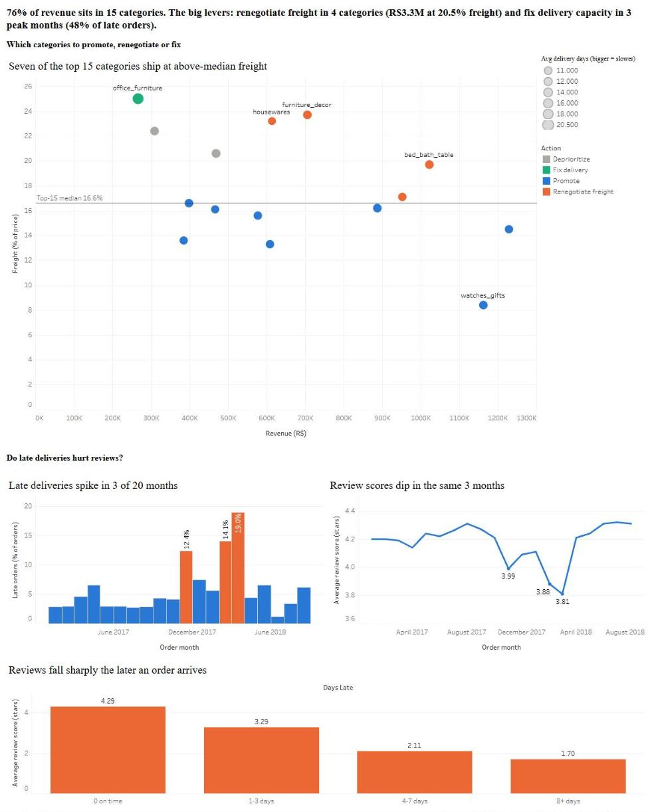

# Olist E-commerce: Revenue vs Freight & Delivery Performance

I ranked Olist's product categories by revenue against what they cost to ship and how reliably they arrive, so finance and ops can decide which categories to promote, which to renegotiate shipping for, and which delivery problems to fix first.

[](https://public.tableau.com/app/profile/henrey.hu/viz/OlistRevenuevsFreightDeliveryPerformance/OlistDashboard)

[Open the interactive dashboard on Tableau Public](https://public.tableau.com/app/profile/henrey.hu/viz/OlistRevenuevsFreightDeliveryPerformance/OlistDashboard). A copy of the workbook is in `tableau/`.

---

## Contents

- [Answer](#answer)
- [Recommendations](#recommendations)
- [Supporting question: does late delivery lower review scores?](#supporting-question-does-late-delivery-lower-review-scores)
- [About this project](#about-this-project)
- [How I structured it](#how-i-structured-it)
- [Challenges and what I learned](#challenges-and-what-i-learned)
- [Limitations](#limitations)
- [Data issues and the late-delivery decisions](#data-issues-and-the-late-delivery-decisions)
- [Reproduce](#reproduce)
- [Credits](#credits)

## Answer

- **Revenue is concentrated.** The top 15 categories make 76% of revenue (R$10.1M of R$13.2M).
- **Freight is the first lever.** Four big categories (bed/bath/table, sports & leisure, furniture & decor, housewares) hold R$3.3M of revenue and pay 20.5% of item price in freight, against 13.7% for the 8 categories worth promoting. Bringing the four down to the top-15 median of 16.6% would cut about R$127K of freight on the same orders (a scenario, not a forecast).
- **Late deliveries are about timing, not categories.** 6.8% of orders arrive after the date Olist promised the customer, and that rate is 5–8% in every top-15 category. But 3 of 20 months (Nov 2017, Feb and Mar 2018) hold 48% of all late orders.
- **One category is slow.** Office furniture takes 20.5 days to deliver on average, against 11–13.6 for the rest, so it needs a delivery fix rather than a freight one.
- **Late orders score lower, but that is a correlation.** The gap is smaller than the headline, see [the supporting question](#supporting-question-does-late-delivery-lower-review-scores).


Chart key. **Promote** means low freight. **Renegotiate freight** means high freight and high revenue. **Deprioritize** means high freight and lower revenue. **Fix delivery** means slow delivery (office furniture only). "High" means above the top-15 median.

Currency is Brazilian reais (R$). Period is orders placed Jan 2017 to Aug 2018, delivered orders only (96,203 orders).

## Recommendations

| # | Action | Owner | Size | Confidence |
|---|---|---|---|---|
| 1 | **Renegotiate freight terms** for bed/bath/table, sports & leisure, furniture & decor, housewares | Ops / seller management, with finance | R$3.30M revenue (33% of top 15), R$674K freight at 20.5% of price | Medium-low. No carrier cost data, and bulky goods have a physical freight floor |
| 2 | **Fix delivery** by adding capacity or tighter seller promises before Nov and Feb–Mar peaks, and investigate office furniture | Ops / logistics | Peak months had 3,158 late orders (48% of all late orders). Office furniture is separate at R$267K, 20.5 days, 3.65 stars | Medium on timing, low on cause. Nov 2017 follows a volume jump, Feb–Mar 2018 do not |
| 3 | **Promote** the 8 low-freight categories, led by watches & gifts (8.4% freight) and health & beauty, and hold promotion of garden tools and telephony until freight improves | Marketing / category management, with finance | R$5.72M revenue (57% of top 15) at 13.7% freight. Held back is R$0.78M at 21.3% | Low-medium. Freight % stands in for margin, true margin is unknown |

Seven of the top 15 categories carry freight above the 16.6% median, holding R$4.3M of revenue. Four of the seven are big enough to renegotiate (R$3.3M). The other three are garden tools and telephony (smaller, so deprioritized) and office furniture (a delivery problem instead).

**Impact scenario (not a forecast).** Cutting the four categories' freight to the 16.6% median would save about R$127K, or about R$64K if only half the gap closed.

## Supporting question: does late delivery lower review scores?

Yes, they move together, but the gap is smaller than the headline. Late orders average 2.27 stars against 4.29 for on-time orders. About 75% of late-order reviews were written *before* the delivery date (customers complaining while still waiting). Without them the gap is 3.52 against 4.29, about 0.8 stars rather than 2.0. I report both numbers. Average score also falls the later an order arrives, from 4.29 on time to 3.29, 2.11 and 1.70 as lateness grows, but late orders may differ in other ways too, so this is correlation and not proof of cause.


## About this project

This is my first data analytics project. I wanted it to look like real work, with a decision-maker with a question, messy data, and a recommendation at the end, rather than a tutorial dataset with a tidy answer. I used the public Olist dataset (nine CSV files, about 100,000 orders from a Brazilian online marketplace, 2016–2018) and spent four weeks on it, from profiling and cleaning the data through to charts, a dashboard and three recommendations.

**Question and audience.** Which product categories bring in the most revenue but lose the most to freight costs and late deliveries? The audience is finance and operations leadership at Olist, a marketplace operator. The stakeholder, hypotheses and framing are written up in `docs/ask.md`.

**Tools.** DuckDB and SQL for cleaning and analysis, Python (pandas, matplotlib) for the charts, Tableau Public for the dashboard, Git and GitHub for version control.

## How I structured it

I followed the six-step analytics cycle (Ask, Prepare, Process, Analyze, Share, Act) and kept one folder or file per step, so anyone can see where each decision was made.

| Step | What I did | Where |
|---|---|---|
| Ask | Stakeholder, question, hypotheses | `docs/ask.md` |
| Prepare | Profiled the nine tables, drew the table relationships, wrote a data dictionary | `docs/profiling.md`, `docs/erd.md`, `docs/data_dictionary.md` |
| Process | Cleaned the data, logged issues, reconciled order totals against payments | `sql/02_cleaning.sql`, `docs/data_issues.md` |
| Analyze | Eleven queries (Q1 to Q11), results saved as CSV | `sql/03_analysis.sql`, `results/` |
| Share | Charts and Tableau dashboard, README answer first | `charts/`, `tableau/` |
| Act | Three recommendations and an impact scenario | Recommendations section above |

**The data layers.** In plain English, I never edit the raw files. I load an untouched copy, build a cleaned copy on top of it, then write saved queries (called views) that give one row per order or one row per category. The table name prefixes show which layer a table belongs to.

| Prefix | Stands for | What it is |
|---|---|---|
| `stg_` | staging | Each CSV exactly as it arrived, so I can always compare against the original |
| `clean_` | cleaned | Types and dates fixed, products with no category bucketed as `unknown`, impossible rows flagged instead of silently deleted |
| `v_` | view | A saved query that fixes what one row means (see "grain" below) |

```
raw CSVs -> stg_* tables -> clean_* tables -> v_* views -> results/q*.csv -> charts + dashboard
            (as loaded)     (fixed + flagged)   (one row per    (the numbers     (what people
                                                 order / category) behind the README) actually see)
```

**Grain** means what one row stands for. `v_order_delivery` has one row per order (late flag, days late, delivery days, review score), `v_category_summary` has one row per category, and `v_category_action` holds the top 15 with their action label. Every number in this README traces to a query in `sql/03_analysis.sql` and a file in `results/` (`q1.csv` to `q11.csv`). Q10 is the freight scenario and Q11 the peak-month count.

**The action-label rule.** Each top-15 category gets one label from a written rule, not from judgment. Slow delivery means Fix delivery, high freight and high revenue means Renegotiate freight, high freight and low revenue means Deprioritize, and everything else means Promote. The rule is in `sql/03a_views.sql`.

## Challenges and what I learned

Most of the work was not the queries. It was finding out where a number could mislead me, and these are the problems that mattered.

**1. Dates were read as the wrong month.** The raw CSVs use day-first dates (`d/m/yyyy`). DuckDB read them correctly, but pandas read them month-first and showed about 24% of orders late instead of about 8%. I only noticed because two tools disagreed. The fix was to give the load step an explicit `timestampformat` (in `sql/01_load_staging.sql`). *Lesson. Check an important number two ways before trusting it.*

**2. What "late" means.** Olist's estimated delivery is always midnight, so comparing timestamps counts a same-day delivery as late. I compared dates instead and wrote the definition at the top of `sql/03_analysis.sql` before running any late-delivery query. *Lesson. Write the definition down first.*

**3. One question, two levels of detail.** Lateness belongs to an order, but category belongs to an item, and some orders contain more than one category. In other words the two have different grains. Joining carelessly would have counted orders twice. I built a one-row-per-order view first, joined items to it (never the other way round), and stated the rule that an order counts once toward every category it contains. *Lesson. Decide what one row means before joining.*

**4. The review gap looked bigger than it was.** The raw gap was about 2 stars, but about 75% of late-order reviews were written before the delivery date, by customers complaining while still waiting. Without them the gap is about 0.8 stars, so I report both (see the supporting question above). *Lesson. When a result is dramatic, look for what is inflating it.*

**5. My hypothesis was wrong, and it changed the recommendation.** The question assumed late deliveries would hurt some categories more than others. They do not. Late % is 5–8% in every top-15 category and spikes by month instead, so the delivery fix is about peak-month capacity and not about picking categories. I kept the original question and let the answer change. *Lesson. A result that disagrees with the hypothesis is still a result.*

**6. Money did not add up at first.** Order totals (price plus freight) did not match payments. After separating rounding noise and installment interest, 24 orders out of about 99,000 stayed unexplained. I logged them in `data_issues_log` instead of forcing a match. *Lesson. A small, documented gap is better than a hidden one.*

## Limitations

- The dataset has no cost of goods, so freight as a % of price is used in place of margin.
- "Late" is measured against Olist's own estimated delivery date, which is padded (median promise about 23 days, median actual about 10), so lateness measures broken promises and not slow shipping.
- Freight is the shipping charge on the order, not a carrier cost. There is no carrier cost per shipment, so the freight scenario shows what the numbers imply and not what Olist would save.
- Review scores and lateness are correlated, not shown to be cause and effect.

## Data issues and the late-delivery decisions

The full log is in `data_issues_log` and written up in `docs/data_issues.md`. Highlights are 610 products with no category plus 13 with an untranslated one (bucketed as `unknown`), and 8 orders marked `delivered` with no delivery date that cannot be scored for lateness.

Decisions that change the late-delivery numbers (written at the top of `sql/03_analysis.sql`).

- **Late** means the delivered *date* is after the estimated *date*. The estimate is always midnight, so a timestamp comparison would count same-day deliveries as late.
- **Window.** Orders purchased Jan 2017 to Aug 2018. Late 2016 (about 330 orders) and Sep–Oct 2018 (about 20, none delivered) distort growth and late %.
- **Scope.** `delivered` orders with a delivery date.
- **Grain.** Lateness is per order and category is per item, so category order counts slightly overlap (see challenge 3).
- **Reviews** are averaged per order first, because some orders have more than one.
- **Dates.** The raw CSVs are day-first, so the load step sets the format explicitly (see challenge 1).

## Reproduce

Run everything from the project folder (the one that contains `sql/` and `scripts/`). Tested on Python 3.12 (Windows).

```bash
pip install -r requirements.txt
python scripts/setup_data.py                      # downloads the CSVs (no Kaggle token needed) and builds data/olist.duckdb
python scripts/run_sql.py sql/02_cleaning.sql     # clean layer, data issues log, payment reconciliation
python scripts/run_sql.py sql/03a_views.sql       # v_order_delivery, v_category_summary, v_category_action
python scripts/run_sql.py sql/03b_issues_log.sql  # adds the timestamp issues to the log
python scripts/run_analysis.py                    # runs sql/03_analysis.sql, writes results/q1.csv to q11.csv
python scripts/make_charts.py                     # writes charts/*.png from results/
python scripts/profile.py                         # optional, writes docs/profiling.md
```

Each step reads the output of the one before it, so run them in this order. The download is about 45 MB and the full run takes a few minutes. I rebuilt every result and chart from scratch following these steps and got the same files.

## Credits

Data is the Brazilian E-Commerce Public Dataset by Olist, from Kaggle.
