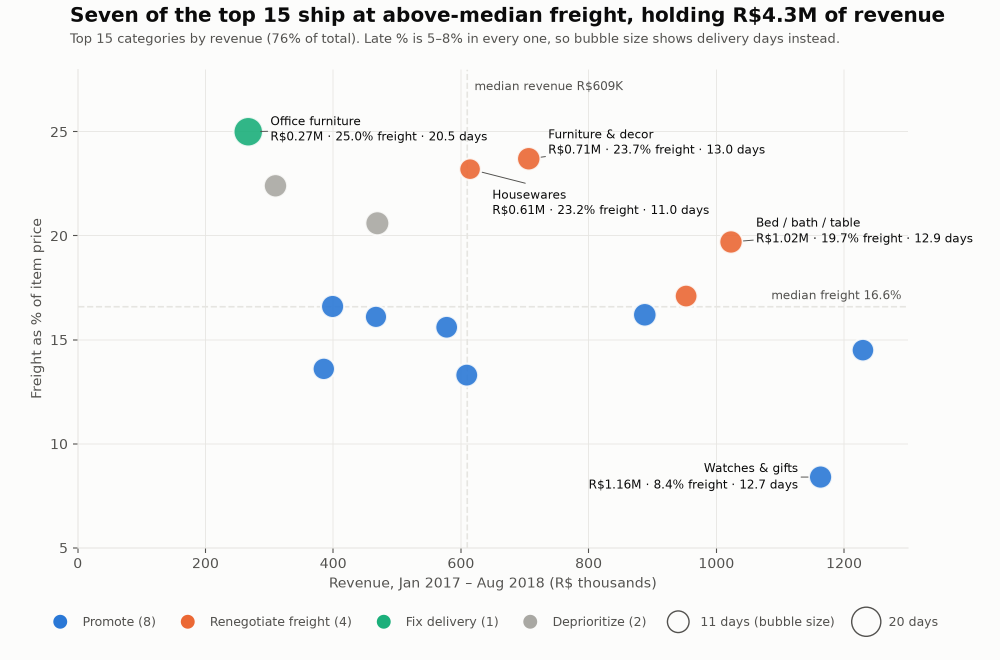
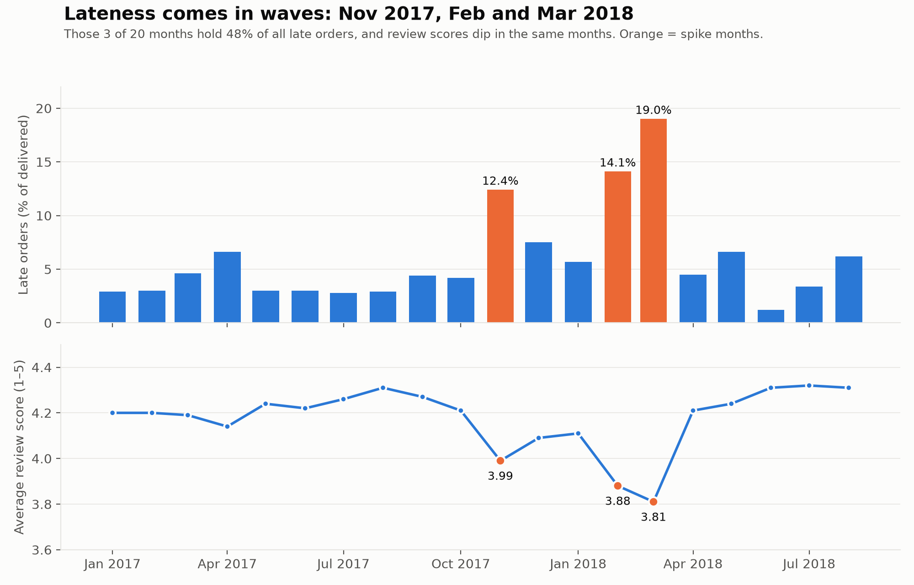
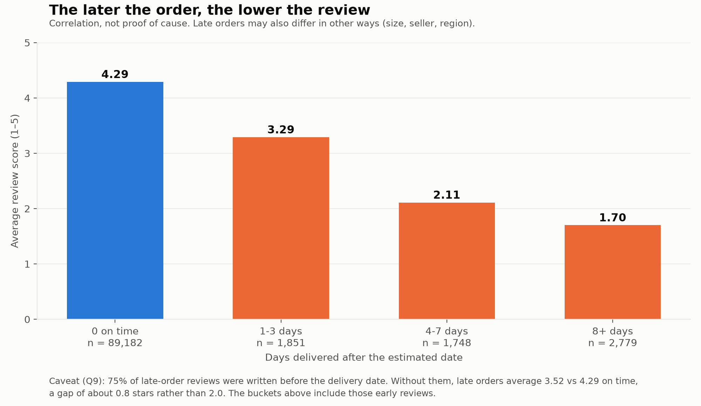

# Olist E-commerce: Revenue vs Freight & Delivery Performance

I ranked Olist's product categories by revenue against what they cost to ship and how reliably they arrive, so finance and ops can decide which categories to promote, which to renegotiate shipping for, and which delivery problems to fix first.

**Interactive dashboard:** [Tableau Public](https://public.tableau.com/app/profile/henrey.hu/viz/OlistRevenuevsFreightDeliveryPerformance/OlistDashboard). A copy of the workbook is in `tableau/`.

## Answer

| 76% | R$3.3M at 20.5% freight | 48% |
|---|---|---|
| of revenue comes from the top 15 categories (R$10.1M of R$13.2M) | revenue in 4 big categories (bed/bath/table, sports & leisure, furniture & decor, housewares) where freight costs 20.5% of item price, against 13.7% for the 8 categories to promote | of all late orders fall in just 3 of 20 months (Nov 2017, Feb and Mar 2018) |

The top 15 categories make 76% of revenue. Seven of them carry freight above 16.6% of price (the top-15 median), holding R$4.3M of revenue. Four of the seven are big enough to renegotiate (R$3.3M); the other three are garden tools and telephony (smaller, so deprioritized) and office furniture (a delivery problem instead). A late order is one delivered after the date Olist promised the customer. 6.8% of orders are late, and late orders score 2.27 stars against 4.29 (a correlation, not proof that lateness causes the low score). Late % is 5–8% in every top-15 category but spikes by month, so the main levers are **freight terms in four categories** and **delivery capacity in the peak months**. Bringing the four categories' freight down to the top-15 median would cut about R$127K of freight on the same orders (a scenario, not a forecast). The one delivery exception is office furniture (20.5 days on average, others 11–13.6).



Chart key: **Promote** = low freight; **Renegotiate freight** = high freight and high revenue; **Deprioritize** = high freight, lower revenue; **Fix delivery** = slow delivery (office furniture only). "High" means above the top-15 median.

Currency is Brazilian reais (R$). Period: orders placed Jan 2017 to Aug 2018, delivered orders only (96,203 orders).

## Recommendations

| # | Action | Owner | Size | Confidence |
|---|---|---|---|---|
| 1 | **Renegotiate freight terms** for bed/bath/table, sports & leisure, furniture & decor, housewares | Ops / seller management, with finance | R$3.30M revenue (33% of top 15), R$674K freight at 20.5% of price | Medium-low: no carrier cost data, and bulky goods have a physical freight floor |
| 2 | **Fix delivery:** add capacity or tighter seller promises before Nov and Feb–Mar peaks; investigate office furniture | Ops / logistics | Peak months: 3,158 late orders in Nov 2017, Feb and Mar 2018 (48% of all late orders). Separately, office furniture: R$267K, 20.5 days, 3.65 stars | Medium on timing, low on cause: Nov 2017 follows a volume jump, Feb–Mar 2018 do not |
| 3 | **Promote** the 8 low-freight categories, led by watches & gifts (8.4% freight) and health & beauty; hold promotion of garden tools and telephony until freight improves | Marketing / category management, with finance | R$5.72M revenue (57% of top 15) at 13.7% freight; held back: R$0.78M at 21.3% | Low-medium: freight % stands in for margin, true margin is unknown |

**Impact scenario (not a forecast).** If the four renegotiation categories' freight fell from 20.5% to the top-15 median of 16.6% on the same orders, freight would be about **R$127K lower** (about R$64K if only half the gap closed). Review-score effects are correlation, not proof of cause: score falls from 4.29 on time to 3.29, 2.11 and 1.70 as lateness grows (below), but late orders may differ in other ways too.

## Supporting question: does late delivery lower review scores?

Yes, they move together, but the gap is smaller than the headline. Late orders average 2.27 stars against 4.29. About 75% of late-order reviews were written *before* the delivery date (customers complaining while still waiting). Without them the gap is 3.52 against 4.29, about 0.8 stars rather than 2.0. Both numbers are reported.





## About this project

This is my first data analytics project. I wanted it to look like real work: a decision-maker with a question, messy data, and a recommendation at the end, rather than a tutorial dataset with a tidy answer. I used the public Olist dataset (nine CSV files, about 100,000 orders from a Brazilian online marketplace, 2016–2018) and over four weeks I:

1. Wrote down who the analysis is for and what they have to decide.
2. Loaded and profiled all nine tables, drew how they connect and wrote a data dictionary.
3. Cleaned the data in SQL, logged every problem I found, and reconciled order totals against payments.
4. Answered the question with SQL queries, each one starting from a written question.
5. Charted the answer in Python and built a Tableau Public dashboard.
6. Turned the findings into three recommendations, each with an owner, a size and a confidence level.

**Question and audience.** Which product categories bring in the most revenue but lose the most to freight costs and late deliveries? The audience is finance and operations leadership at Olist, a marketplace operator. The stakeholder, hypotheses and framing are written up in docs/ask.md.

**Tools:** DuckDB and SQL for cleaning and analysis, Python (pandas, matplotlib) for the charts, Tableau Public for the dashboard, Git and GitHub for version control.

## How I structured it

**The process.** I followed the six-step analytics cycle (Ask, Prepare, Process, Analyze, Share, Act) and kept one folder or file per step, so anyone can see where each decision was made.

| Step | What I did | Where |
|---|---|---|
| Ask | Stakeholder, question, hypotheses | docs/ask.md |
| Prepare | Profiled the nine tables, drew the table relationships, wrote a data dictionary | docs/profiling.md, docs/erd.md, docs/data_dictionary.md |
| Process | Cleaned the data, logged issues, reconciled order totals against payments | sql/02_cleaning.sql, docs/data_issues.md |
| Analyze | Eleven queries (Q1 to Q11), results saved as CSV | sql/03_analysis.sql, results/ |
| Share | Charts and Tableau dashboard, README answer first | charts/, tableau/ |
| Act | Three recommendations and an impact scenario | Recommendations section above |

**The data layers.** I did not query the raw files directly. Data moves through layers, and each layer does one job:

```
raw CSVs -> stg_* tables -> clean_* tables -> v_* views -> results/q*.csv -> charts + dashboard
            (as loaded)     (fixed + flagged)   (one row per    (the numbers     (what people
                                                 order / category) behind the README) actually see)
```

- **Staging (`stg_*`)** holds each CSV as it arrived, so I can always compare against the original.
- **Clean (`clean_*`)** fixes types and dates, buckets products with no category as `unknown`, and flags impossible rows instead of silently deleting them.
- **Views (`v_*`)** set the grain: `v_order_delivery` is one row per order (late flag, days late, delivery days, review score), `v_category_summary` is one row per category, and `v_category_action` holds the top 15 with their action label.
- **Results** are saved from the queries, so every number in this README traces to a query in `sql/03_analysis.sql` and a file in `results/` (`q1.csv` to `q11.csv`). Q10 is the freight scenario and Q11 the peak-month count.

**The action-label rule.** Each top-15 category gets one label from a written rule, not from judgment: slow delivery = Fix delivery; high freight and high revenue = Renegotiate freight; high freight and low revenue = Deprioritize; everything else = Promote. "High" means above the top-15 median (the rule is in `sql/03a_views.sql`).

**Folder map**

```
sql/        01 load, 02 cleaning, 03a views, 03 analysis queries
scripts/    setup, profiling, running the queries, making the charts
results/    one CSV per query
charts/     the three charts used above
tableau/    the Tableau Public workbook
docs/       ask, profiling, ERD, data dictionary, data issues, findings
```

## Challenges and what I learned

Most of the work was not the queries. It was finding out where a number could mislead me, and these are the problems that mattered.

**1. Dates were read as the wrong month.** The raw CSVs use day-first dates (`d/m/yyyy`). DuckDB read them correctly, but pandas read them month-first and showed about 24% of orders late instead of about 8%. I only noticed because two tools disagreed. The fix was to give the load step an explicit `timestampformat` (in `sql/01_load_staging.sql`). *Lesson: check an important number two ways before trusting it.*

**2. What "late" means.** Olist's estimated delivery is always midnight, so comparing timestamps counts a same-day delivery as late. I compared dates instead and wrote the definition at the top of `sql/03_analysis.sql` before running any late-delivery query. *Lesson: write the definition down first.*

**3. One question, two different grains.** Lateness belongs to an order, but category belongs to an item, and some orders contain more than one category. Joining carelessly would have counted orders twice. I built a one-row-per-order view first, joined items to it (never the other way round), and stated the rule: an order counts once toward every category it contains. *Lesson: decide what one row means before joining.*

**4. The review gap looked bigger than it was.** Late orders scored 2.27 stars against 4.29, a gap of about 2 stars. But 4,775 late-order reviews (about 75% of them) were written before the delivery date, by customers complaining while still waiting. Without them the gap is about 0.8 stars. I report both numbers. *Lesson: when a result is dramatic, look for what is inflating it.*

**5. My hypothesis was wrong, and it changed the recommendation.** The question assumed late deliveries would hurt some categories more than others. They do not: late % is 5–8% in every top-15 category. It spikes by month instead, and 3 months hold 48% of all late orders. So the delivery fix is about peak-month capacity, not about picking categories. I kept the original question and let the answer change. *Lesson: a result that disagrees with the hypothesis is still a result.*

**6. Money did not add up at first.** Order totals (price plus freight) did not match payments. After separating rounding noise and installment interest, 24 orders out of about 99,000 stayed unexplained. I logged them in `data_issues_log` instead of forcing a match. *Lesson: a small, documented gap is better than a hidden one.*

## Limitations
- The dataset has no cost of goods, so freight as a % of price is used in place of margin.
- "Late" is measured against Olist's own estimated delivery date, which is padded (median promise about 23 days, median actual about 10), so lateness measures broken promises, not slow shipping.
- Freight is the shipping charge on the order, not a carrier cost. There is no carrier cost per shipment, so the freight scenario shows what the numbers imply, not what Olist would save.
- Review scores and lateness are correlated, not shown to be cause and effect.

## Data issues and the late-delivery decisions

The full log is in `data_issues_log` and written up in docs/data_issues.md. Highlights: 610 products with no category + 13 with an untranslated one were bucketed as `unknown`; 8 orders are marked `delivered` but have no delivery date and can't be scored for lateness; reconciling order totals against payments left only 24 orders (out of about 99k) genuinely unexplained after separating out rounding noise and installment interest.

Decisions that change the late-delivery numbers (written at the top of `sql/03_analysis.sql`):
- **Late** = delivered *date* after estimated *date*. The estimate is always midnight, so a timestamp comparison would count same-day deliveries as late.
- **Window**: orders purchased Jan 2017 to Aug 2018. Late 2016 (about 330 orders) and Sep–Oct 2018 (about 20, none delivered) distort growth and late %.
- **Scope**: `delivered` orders with a delivery date.
- **Grain**: lateness is per order, category is per item. An order counts once toward every category it contains, so category order counts slightly overlap.
- **Reviews** are averaged per order first, because some orders have more than one.
- **Dates**: the raw CSVs are day-first (`d/m/yyyy`), so `sql/01_load_staging.sql` reads the orders file with an explicit `timestampformat`. Tools that assume month-first (the pandas default) misread them and badly overstate late orders.

## Reproduce
Run everything from the project folder (the one that contains `sql/` and `scripts/`). Tested on Python 3.12 (Windows).
```bash
pip install -r requirements.txt
python scripts/setup_data.py                      # downloads the CSVs (no Kaggle token needed) and builds data/olist.duckdb
python scripts/run_sql.py sql/02_cleaning.sql     # clean layer, data issues log, payment reconciliation
python scripts/run_sql.py sql/03a_views.sql       # v_order_delivery, v_category_summary, v_category_action
python scripts/run_sql.py sql/03b_issues_log.sql  # adds the timestamp issues to the log
python scripts/run_analysis.py                    # runs sql/03_analysis.sql, writes results/q1.csv to q11.csv
python scripts/make_charts.py                     # writes charts/*.png from results/
python scripts/profile.py                         # optional: writes docs/profiling.md
```
Each step reads the output of the one before it, so run them in this order. The download is about 45 MB and the full run takes a few minutes. I rebuilt every result and chart from scratch following these steps and got the same files.
